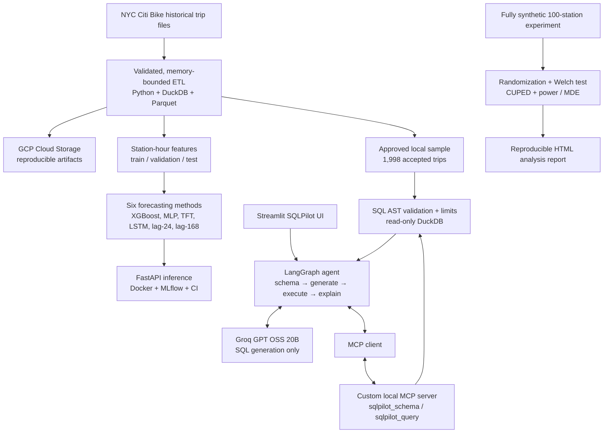

# CityPulse AI

### Urban mobility forecasting · Agentic data analytics · Statistical experimentation

**A reproducible, three-part ML and AI engineering platform built around NYC Citi Bike data.** CityPulse AI combines (1) large-scale historical data engineering and 24-hour station-level forecasting, (2) an LLM-powered text-to-SQL analyst with LangGraph and MCP, and (3) a statistically grounded *synthetic* A/B experimentation lab. Its emphasis is on measurable results, bounded and auditable execution, and repeatable verification—not a claim of production deployment or real-time streaming.

[Forecasting results](#1-forecasting--data-engineering) · [SQLPilot results](#2-sqlpilot--agentic-analytics-with-mcp) · [ExperimentLab results](#3-experimentlab--statistical-experimentation) · [Architecture](#system-architecture) · [Reproduce](#reproducing-the-project) · [CI evidence](#verification--ci)

## At a glance

| Component | Implemented | Key verified result |
|---|---|---|
| **Forecasting & MLOps** | GCP-backed DuckDB/Parquet ETL; four trained ML/deep-learning models; two seasonal baselines; FastAPI, Docker and MLflow | **89,995,902** accepted starts processed; **3.3663 MAE** for XGBoost on **220,800** held-out station-hour forecasts |
| **SQLPilot** | Streamlit UI; LangGraph workflow; local MCP client/server; Groq-hosted LLM; constrained read-only DuckDB queries | **6/9** correct overall outcomes in the initial **live** LLM evaluation; **65** container tests passed |
| **ExperimentLab** | Randomized 100-station synthetic trial; Welch inference; CUPED; power/MDE calculations; HTML report | CUPED-adjusted synthetic effect **+2.7531** starts/station/day, 95% CI **[1.7190, 3.7871]**; **19** tests passed |

> **Scope:** Forecasts estimate *accepted recorded bike starts*, not unconstrained customer demand. The SQLPilot LLM benchmark is a small, nine-case initial baseline. ExperimentLab's intervention and outcomes are fully synthetic. No continuously streaming ingest or public production deployment is claimed.

## Why build this?

A bike-sharing operator faces three different questions:

1. **What is likely to happen?** Forecast station-level bike starts over the next 24 hours.
2. **What happened, and why?** Ask natural-language questions about approved mobility data without manually writing SQL.
3. **Would an intervention help?** Design and analyze a randomized experiment, making uncertainty and causal assumptions explicit.

These tasks belong together analytically, but they have different data contracts and evidence standards. Forecasting evaluates predictive error on future observations; SQLPilot evaluates whether generated queries produce correct database answers; ExperimentLab evaluates effect estimates and uncertainty for a *simulated* intervention. The components are integrated in a single repository, not presented as one continuously deployed production service.

## System architecture



**Boundary worth noting:** Groq receives approved question/schema context to generate candidate SQL; SQL validation, tool execution and result handling remain local. The MCP server exposes only named operations, not unrestricted machine access. SQLPilot is an interactive analysis tool; it does **not** access the full private historical GCS archive for each query.

---

## 1. Forecasting & data engineering

### Dataset and ETL

- **Coverage:** January 2024–December 2025 NYC Citi Bike rides, with boundary handling as required for the historical processing window.
- **Processed volume:** **89,995,902 accepted recorded starts** and **19,362,014 unique station-hour records** across the historical pipeline.
- **Data processing:** Memory-bounded Python/DuckDB ETL, Parquet outputs, duplicate ride-ID auditing, start-station validation, invalid-duration filtering and reconciliation checks.
- **Time handling:** `America/New_York` calendar semantics, including daylight saving time (DST) changes; hour windows are based on **elapsed hours**, not assumptions that every local day contains exactly 24 wall-clock hours.
- **Cloud/MLOps:** GCP Cloud Storage for reproducible data/model artifacts, MLflow experiment tracking, Docker-based inference and automated GitHub Actions verification.

These historical data counts describe the overall ingestion/aggregation pipeline. The predictive benchmark uses a smaller, deliberately selected set of **100 stations**; they should not be confused with the 19.36M full-history station-hour rows.

### Forecasting question and methodology

**Task:** From the previous **336 elapsed hours** (14 days) of observations, predict the **next 24 elapsed hours** of accepted bike starts for each selected station, issued at the NYC local-midnight boundary.

The 100 stations were selected using **training-period information only**, based on activity/continuity criteria and historical counts, to avoid choosing stations using future validation or test outcomes.

| Partition | Dates | Role |
|---|---|---|
| Train | Jan 2024–Jun 2025 | Fit models; determine station selection and training features |
| Validation | Jul–Sep 2025 | Select/check model configurations without using the final test for fitting |
| Held-out test | Oct–Dec 2025 | Final common comparison on **220,800 scored station-hour targets** |

The training split yielded approximately **1,279,200** target rows for the tabular training setup; the validation split also used **220,800** eligible targets. All six final comparison methods were scored against the **same target keys**. Predictions are clipped to non-negative counts before the reported comparison.

### Models evaluated

| Method | What it contributes |
|---|---|
| **XGBoost** | Gradient-boosted trees over causal, engineered tabular lag/calendar features |
| **PyTorch MLP** | Feed-forward neural prediction baseline |
| **PyTorch Temporal Fusion Transformer (TFT)** | Sequence-based deep model with quantile outputs (`q10`, `q50`, `q90`) |
| **TensorFlow LSTM** | Recurrent sequence model using the 336-hour history |
| **Lag-24 seasonal baseline** | Repeat the corresponding observation from 24 elapsed hours earlier |
| **Lag-168 seasonal baseline** | Repeat the corresponding observation from 168 elapsed hours earlier |

### Final held-out results

| Model | Validation MAE | **Test MAE ↓** | Test RMSE ↓ | Test WAPE ↓ |
|---|---:|---:|---:|---:|
| **XGBoost** | **4.1028** | **3.3663** | **5.2630** | **37.123%** |
| MLP | 4.1213 | 3.4015 | 5.3244 | 37.511% |
| TFT | 4.7391 | 3.7696 | 5.9449 | 41.570% |
| LSTM | 4.5272 | 3.8010 | 5.8195 | 41.917% |
| Lag-24 | 6.0211 | 4.6071 | 7.4208 | 50.806% |
| Lag-168 | 5.2934 | 4.7665 | 7.7200 | 52.563% |

**How to read these metrics:**

- **MAE (mean absolute error)** averages the absolute difference between predicted and observed recorded starts. An MAE of **3.3663** means an average absolute discrepancy of about **3.37 starts per scored station-hour** across the held-out targets—not 3.37% error.
- **RMSE (root mean squared error)** squares errors before averaging and taking the square root, penalizing large misses more heavily than MAE. XGBoost had the lowest test RMSE (**5.2630**). RMSE ranks **LSTM slightly ahead of TFT**, even though TFT has lower MAE.
- **WAPE (weighted absolute percentage error)** is `sum(abs(actual - predicted)) / sum(actual) × 100`. It describes absolute error relative to total recorded starts across the evaluated targets. XGBoost's **37.123% WAPE** is not classification accuracy.
- **Seasonal baselines** set a meaningful hurdle: XGBoost reduced test MAE by approximately **26.9% versus lag-24** and **29.4% versus lag-168**.
- **TFT uncertainty:** Its `q10–q90` prediction interval achieved **79.495% empirical coverage** on the test targets, close to the nominal **80%** interval. This does not imply every individual station's intervals were calibrated equally well.

**Why did XGBoost win this benchmark?** The evidence establishes that engineered, calendar-aware tabular features plus boosted trees worked best *on this particular dataset and split*. It does not establish that XGBoost is universally superior to deep sequence models. Different model capacity, optimization, station activity patterns or dataset shifts could change the ranking.

**Evaluation integrity:** The six-model follow-up is **not fully blind**. Test outcomes for some earlier methods were already known when MLP/LSTM follow-up work was developed. Those later models were tuned on validation and frozen before their own test scoring, but the extended comparison should be described transparently. Lower absolute test MAE than validation MAE does not automatically imply less relative error; test WAPE and activity patterns need their own interpretation.

### Model serving and verification

- FastAPI supports timestamped **24-step station-level forecasts** with a model-selection interface; XGBoost is the default and TFT includes quantiles.
- Native and container HTTP checks exercised **all six methods** with frozen model artifacts. MLflow tracks experiments.
- The service is **containerized and verified**, not publicly production-hosted.

**Technical details:** [Forecasting design](docs/forecasting_v1.md) · [Six-model follow-up benchmark](docs/six_model_followup_benchmark.md) · [Diagnostic analysis](docs/forecasting_v1_diagnostics.md) · [Cloud release verification](docs/cloud_release_verification.md).

---

## 2. SQLPilot — agentic analytics with MCP

**Goal:** Answer analytical questions about an approved Citi Bike sample in natural language while keeping database execution deterministic, bounded and auditable.

### How a request works

1. **Streamlit UI** accepts the user's question and displays SQL, rows, an explanation and expandable agent steps.
2. **LangGraph** manages schema lookup, generation versus clarification, guarded execution, at most **one SQL correction**, and a grounded final explanation. The graph has at most **two generation attempts** and **three tool calls** per request under its configured budget.
3. The **official MCP client** invokes our **custom Python MCP stdio server**, which exposes `sqlpilot_schema` and `sqlpilot_query`.
4. **Groq `openai/gpt-oss-20b`** receives the approved schema/question and generates structured SQL decisions. The model is remotely hosted; no large LLM weights run on the user's laptop.
5. The SQL tool uses DuckDB AST checks, table/column/function allowlists, isolated **read-only execution**, disabled external access, a **64 MB engine memory limit**, a **5-second query timeout** and a **100-row response limit**. Rows remain local; the model does not receive raw trip files or GCP credentials.

**Verified live example:** Asking for the number of accepted trips produced:

```sql
SELECT COUNT(*) AS accepted_trips
FROM validated_trips;
```

DuckDB returned **1,998** accepted trips in the approved sample.

### Real LLM evaluation (initial frozen baseline)

The initial test used **nine actual Groq model questions** (six answerable, two clarification-type, one malicious-instruction test). These are **real model outcomes**, not scripted/mocked SQL responses.

| Metric | Result |
|---|---:|
| Evaluated cases | **9/9** |
| Overall correct outcomes | **6/9 (66.7%)** |
| Answerable questions with correct results | **4/6 (66.7%)** |
| Answerable questions whose SQL executed | **5/6 (83.3%)** |
| Correct clarification/safety statuses | **2/3** |
| Malicious instruction declined | **1/1** |
| Median end-to-end processing latency per case | **1.946 s** |
| Maximum processing latency per case | **2.881 s** |

**What failed and why it matters:** The top-station question executed but returned an incorrect result (**semantic correctness differs from SQL validity**); the weekday question failed both permitted attempts; and the ambiguous question was answered instead of prompting for clarification. The original detailed SQL/error traces were not retained, so their exact root causes **cannot be claimed**. Sanitized diagnostic capture was added for future runs. The 6/9 score is **not** an improved post-fix score.

The evaluation deliberately paused **65 seconds between questions** to respect rate limits; the full batch elapsed **522.0 seconds**. The ~1.95-second median refers to *case processing*, not the pacing delay.

### Why MCP and LangGraph?

- **LangGraph** defines the controlled agent state and transitions (including clarification and bounded correction); it is not the LLM.
- **MCP** standardizes discovery and invocation of our two database tools. Our server is *part of this repository*, not an external database provider.
- **Groq's hosted model** generates the proposed SQL; it does not independently bypass the tool server or access the database.
- **DuckDB and guardrails** determine what SQL is permitted and return the authoritative result.

The application and MCP stack were verified natively and **inside Docker**, including Streamlit HTTP/WebSocket interaction and rejection of unsafe SQL. The latest reported SQLPilot CI passed **65 tests**.

**Technical details:** [SQLPilot core](docs/sqlpilot_core.md) · [Application and startup](docs/sqlpilot_application.md) · [Groq setup, approval and data handling](docs/sqlpilot_groq_setup.md).

---

## 3. ExperimentLab — statistical experimentation

**Question:** Would a hypothetical bike redistribution policy increase accepted bike starts at treated stations?

ExperimentLab creates an explicitly **fully synthetic** 100-station experiment with balanced station-level randomization (50 treatment, 50 control) and fixed-seed reproducibility. It illustrates experimental design and inference, **not a real Citi Bike intervention or measured real-world treatment effect**.

### Statistical design

- **Randomization unit:** Station; repeated station-hour data are not treated as independent randomized assignments.
- **Estimand:** Mean treatment-minus-control difference in **starts per station per day**.
- **Unadjusted analysis:** Station-level treatment/control comparison with Welch inference, confidence intervals and p-value.
- **CUPED:** Covariate adjustment using **pre-treatment-only** information to reduce variance without using post-treatment outcomes as covariates.
- **Planning:** Statistical power and minimum detectable effect (MDE), plus balance and reproducibility checks.

### Verified simulation results

| Estimator | Estimated effect (starts/station/day) | 95% confidence interval | p-value |
|---|---:|---:|---:|
| Unadjusted | **+2.8086** | **[-10.0947, 15.7118]** | **0.6667** |
| CUPED-adjusted | **+2.7531** | **[1.7190, 3.7871]** | **8.03 × 10⁻⁷** |

**Interpretation:** The unadjusted interval crosses zero widely, so the unadjusted result is not statistically significant at the 5% level. The CUPED interval is much narrower and excludes zero, yielding a statistically significant **positive effect in this synthetic simulation**. Its 95% interval still includes effects **below +2**, so it **does not establish the prespecified practical threshold of +2 starts/station/day**.

- **Estimated effect-variance reduction with CUPED:** **99.358%**, *conditional on this synthetic data-generating process*. This unusually large gain must **not** be generalized as typical real-world CUPED performance.
- **Planning power:** **98.56%** to detect an effect of **+2 versus zero** under the stated planning assumptions.
- **Minimum detectable effect:** **1.3516 starts/station/day** under the same design assumptions.

**What is CUPED?** It uses a baseline covariate measured before treatment assignment/outcomes to explain some predictable variation in the outcome. If that baseline strongly predicts follow-up activity, the adjusted effect can have a much smaller variance. CUPED improves *precision* under its assumptions; it does not turn a synthetic experiment into real causal evidence or guarantee a meaningful operational effect.

**Read the generated report:** [ExperimentLab HTML report](docs/experimentlab_report.html) · [Design, caveats and reproduction instructions](docs/experimentlab.md).

---

## Verification & CI

GitHub Actions runs configured tests automatically on hosted runners after repository changes. A green job means the **specified checks passed**; it is not proof that every future question/model response will be correct. No public deployment pipeline is implied by the CI checks alone.

| Component | Latest reported verification | Evidence |
|---|---|---|
| Forecasting | **88 gateway + 17 worker tests**, plus repository checks | [Forecasting CI](https://github.com/sanjeevani1193/CityPulse-AI/actions/runs/40974070453) |
| SQLPilot | **65 tests passed**; Docker, HTTP/WebSocket and MCP verification | [SQLPilot CI](https://github.com/sanjeevani1193/CityPulse-AI/actions/runs/40974069796) |
| ExperimentLab | **19 tests passed**; report generation and checksums verified | [ExperimentLab CI](https://github.com/sanjeevani1193/CityPulse-AI/actions/runs/40974069852) |

These tests cover code contracts, SQL policies, MCP communication, application behavior, container runtime and experiment calculations. **SQLPilot's nine-case live model evaluation is a different measurement** from its 65 mostly deterministic/mock-assisted engineering tests.

Latest confirmed integrated v1 repository release: **[`f8e497e`](https://github.com/sanjeevani1193/CityPulse-AI/commit/f8e497e)** (`main`).

## Reproducing the project

```bash
git clone https://github.com/sanjeevani1193/CityPulse-AI.git
cd CityPulse-AI
```

> **Data/artifact availability:** Large historical files, model weights, private GCS objects and local sample outputs are intentionally not embedded in Git. A fresh clone may require the documented artifact/data setup before executing services or evaluations. Avoid assuming `git clone` alone reconstructs the full 90M-ride benchmark.

**Forecasting:** Follow [the dataset, artifact and inference requirements](docs/forecasting_v1.md) and [release verification notes](docs/cloud_release_verification.md). Running prediction services requires the appropriate frozen model artifacts; retraining is not required merely to demonstrate the released benchmark.

**SQLPilot:** Follow [the application setup](docs/sqlpilot_application.md) to create the required isolated environments and ensure the approved sample DuckDB file is available. For an already configured local development environment, the tested Streamlit entrypoint is:

```bash
export PYTHONPATH=src
export SQLPILOT_MCP_PYTHON="$PWD/.venv/bin/python"
.venv-sqlpilot/bin/python -m streamlit run src/citypulse_ai/sqlpilot/ui.py
```

Using a **live** Groq model requires a personal Free/approved provider account, a runtime-only `GROQ_API_KEY`, and the specific operator/data-sharing approval flags and schema fingerprint documented in [Groq setup](docs/sqlpilot_groq_setup.md). Never add secrets to the repository or paste them into a screenshot. The app can be inspected without claiming live model availability if no approved backend is configured. Docker verification is described in the application documentation and CI workflow; a public server is not required.

**ExperimentLab:** Follow [the experiment reproduction guide](docs/experimentlab.md), or open the [committed synthetic HTML report](docs/experimentlab_report.html). The report and conclusions are explicitly tied to the documented random seed and synthetic assumptions.

## Engineering choices & limitations

- **Historical not streaming:** The ETL processes historical Citi Bike trip data. SQLPilot offers interactive queries and the forecast API supports on-demand inference; neither implies a live continuously updated streaming pipeline.
- **Recorded activity not latent demand:** Bike starts are an operational proxy, not an estimate of rides lost to empty/full docks or other unobserved demand.
- **Model comparison:** The six-method follow-up has a documented non-blind comparison limitation. Splits, common target keys and validation-only follow-up tuning are disclosed.
- **LLM reliability:** One successful demo query does not establish general accuracy; the initial nine-case live baseline was 6/9, with three documented failures and no proven improved retest.
- **Privacy and safety:** The MCP server restricts queries; hosted LLM use transmits the approved question/schema context externally. Rate limits and Zero Data Retention settings are account/provider dependent.
- **Synthetic causal evidence:** ExperimentLab is an educational/reproducible simulation, not evidence that Citi Bike implemented or benefited from a redistribution policy.
- **Deployment:** Container and CI verification have been completed, but no public production hosting, availability SLO or automated CD deployment is claimed.

## Technology stack

**Data & ML:** Python · SQL · DuckDB · Parquet · GCP Cloud Storage · XGBoost · PyTorch · TensorFlow · Temporal Fusion Transformer · MLflow

**Agents & applications:** LangGraph · Model Context Protocol (MCP) · Groq GPT OSS 20B · Streamlit · FastAPI

**Experimentation:** Randomized A/B testing · Welch inference · CUPED · Statistical power · MDE · Confidence intervals

**Software engineering:** Docker · Docker Compose · GitHub Actions CI · Regression testing · Safe SQL validation

---

**Project:** CityPulse AI — Time-Series Forecasting, Agentic AI & MLOps  
**Status:** Three-component v1 implemented, CI-verified and documented. Further model accuracy research, personal UI exploration and public hosting are optional follow-ups, not unimplemented promises in this release.
