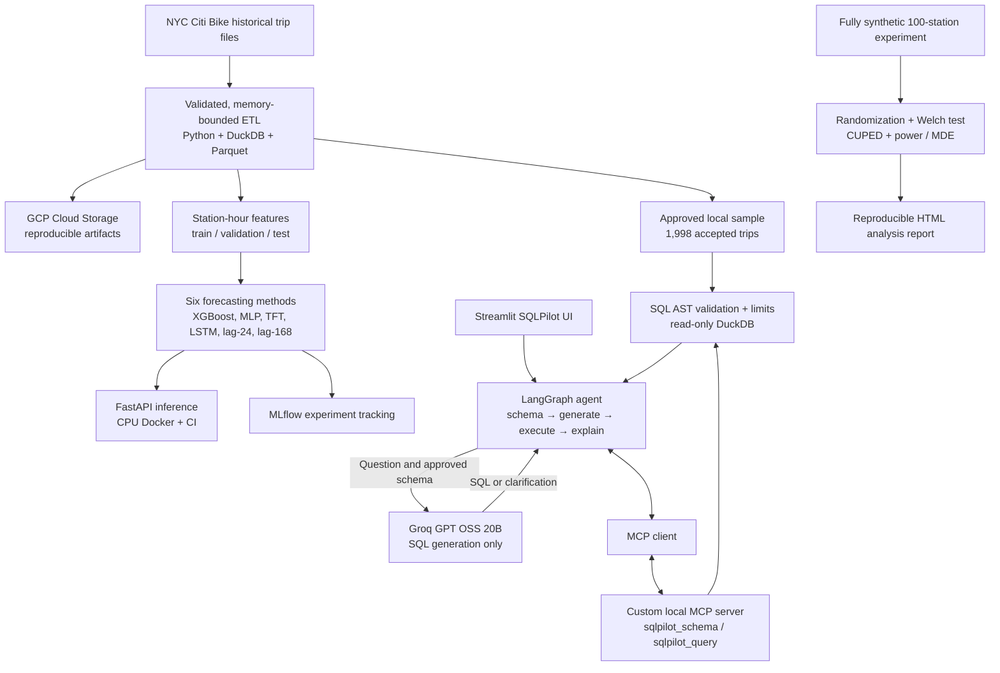
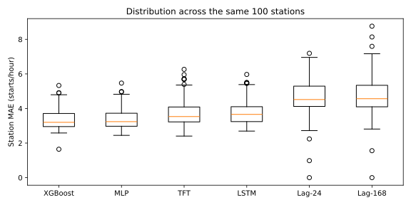

# CityPulse AI

### Urban mobility forecasting · Agentic data analytics · Statistical experimentation

**A reproducible, three-part ML and AI engineering platform built around NYC Citi Bike data.** CityPulse AI combines (1) large-scale historical data engineering and 24-hour station-level forecasting, (2) an LLM-powered text-to-SQL analyst with LangGraph and MCP, and (3) a statistically grounded *synthetic* A/B experimentation lab. Its emphasis is on measurable results, bounded and auditable execution, and repeatable verification—not a claim of production deployment or real-time streaming.

[Forecasting](#forecasting) · [SQLPilot](#sqlpilot) · [ExperimentLab](#experimentlab) · [Architecture](#architecture) · [Reproduce](#reproduce) · [CI evidence](#verification) · [Limitations](#limitations) · [Documentation](#documentation)

## At a glance

| Component | Implemented | Key verified result |
|---|---|---|
| **Forecasting & MLOps** | GCP-backed DuckDB/Parquet ETL; four trained ML/deep-learning models; two seasonal baselines; FastAPI, Docker and MLflow | **89,995,902** accepted starts processed; **3.3663 MAE** for XGBoost on **220,800** held-out station-hour forecasts |
| **SQLPilot** | Streamlit UI; LangGraph workflow; local MCP client/server; Groq-hosted LLM; constrained read-only DuckDB queries | **6/9** correct overall outcomes in the initial **live** LLM evaluation; **65** container tests passed |
| **ExperimentLab** | Randomized 100-station synthetic trial; Welch inference; CUPED; power/MDE calculations; HTML report | CUPED-adjusted synthetic effect **+2.7531** starts/station/day, 95% CI **[1.7190, 3.7871]**; **19** tests passed |

> **Scope:** Forecasts estimate *accepted recorded bike starts*, not unconstrained customer demand. The SQLPilot LLM benchmark is a small, nine-case initial baseline. ExperimentLab's intervention and outcomes are fully synthetic. No continuously streaming ingest or public production deployment is claimed.

## Why build this?

A bike-sharing operator faces three different questions:

1. **What is likely to happen?** Forecast station-level bike starts over the next 24 hours.
2. **What happened, and why?** Ask natural-language questions about approved mobility data without manually writing SQL.
3. **Would an intervention help?** Design and analyze a randomized experiment, making uncertainty and causal assumptions explicit.

These tasks belong together analytically, but they have different data contracts and evidence standards. Forecasting evaluates predictive error on future observations; SQLPilot evaluates whether generated queries produce correct database answers; ExperimentLab evaluates effect estimates and uncertainty for a *simulated* intervention. The components are integrated in a single repository, not presented as one continuously deployed production service.

<a id="architecture"></a>

## System architecture



**Boundary worth noting:** Groq receives approved question/schema context to generate candidate SQL; SQL validation, tool execution and result handling remain local. The MCP server exposes only named operations, not unrestricted machine access. SQLPilot is an interactive analysis tool; it does **not** access the full private historical GCS archive for each query.

---

<a id="forecasting"></a>

## 1. Forecasting & data engineering

### Dataset and ETL

- **Coverage:** all 24 NYC-local months, January 2024–December 2025, finalized using **25 source archives**. January 2026 is a boundary source only; its January-local rides are excluded from modelling.
- **Processed volume:** **89,995,902 accepted recorded starts** and **19,362,014 unique station-hour records** within the modelling window. The final audit found **zero duplicate ride IDs or station-hour keys**. These are accepted-record counts, not a claim that the publisher observed every physical rental.
- **Data processing:** Memory-bounded Python/DuckDB ETL, Parquet outputs, duplicate ride-ID auditing, start-station validation, invalid-duration filtering and reconciliation checks.
- **Time handling:** `America/New_York` calendar semantics, including daylight saving time (DST) changes; hour windows are based on **elapsed hours**, not assumptions that every local day contains exactly 24 wall-clock hours.
- **Cloud/MLOps:** GCP Cloud Storage for reproducible data/model artifacts, MLflow experiment tracking, Docker-based inference and automated GitHub Actions verification.

These historical data counts describe the overall ingestion/aggregation pipeline. The predictive benchmark uses a smaller, deliberately selected set of **100 stations**; they should not be confused with the 19.36M full-history station-hour rows.

### Forecasting question and methodology

**Task:** From the previous **336 elapsed hours** (14 days) of observations, predict the **next 24 elapsed hours** of accepted bike starts for each selected station, issued at the NYC local-midnight boundary.

The final selector examined **2,386 stations**, found **1,828 eligible**, and froze
exactly **100** using **January 2024–June 2025 only**. Eligibility requires at least
**15 active local dates in every training month** and no inactivity run longer
than **14 local dates**, including leading/trailing gaps. Rank by accepted
training starts descending, then exact station ID ascending. These activity
proxies do not prove station operating status. See the
[final dataset contract](docs/final_tft_dataset.md).

| Partition | Dates | Role |
|---|---|---|
| Train | Jan 2024–Jun 2025 | Fit models; determine station selection and training features |
| Validation | Jul–Sep 2025 | Select/check model configurations without using the final test for fitting |
| Held-out test | Oct–Dec 2025 | Final common comparison on **220,800 scored station-hour targets** |

| Dataset quantity | Train | Validation | Test |
|---|---:|---:|---:|
| Unique station-hour panel rows | 1,312,700 | 220,800 | 220,900 |
| Eligible station-origin windows | 53,300 | 9,200 | 9,200 |
| Trusted forecast target positions | 1,279,200 | 220,800 | 220,800 |

The panel totals **1,754,400** station-hours. Under
`accepted_recorded_starts_v1`, verified absent accepted-record keys are certified
source-scoped zeros; unverified periods fail closed. This final panel has zero
unknown count labels, while **operating availability remains independently
unknown** without station-status evidence. Cohort selection and all fitted
normalization use training data only. Data loading is lazy; all tensors are not
materialized in RAM.

All methods share the exact eligible validation/test keys. Inverse scaling, where applicable, is
followed by the predeclared `max(0, prediction)` floor; no rounding is applied.
On November 2, 2025, both 01:00 offsets are included, but the 24-elapsed-hour
horizon ends at 22:00 EST: **100 station-hours at 23:00 EST are unscored**.
Spring horizons may extend into the next local date; split-crossing horizons are
excluded. These are elapsed-hour forecasts, not padded calendar days.

### Models evaluated

| Method | What it contributes |
|---|---|
| **XGBoost** | CPU XGBoost 3.2.0; 300 trees, depth 6, learning rate 0.05, seed 42; 48 causal tabular features |
| **PyTorch MLP** | 194 → 32 ReLU → 16 ReLU → 1; 6,785 parameters; selected `epoch-010.pt` from 15 completed epochs |
| **PyTorch Temporal Fusion Transformer (TFT)** | Native station embeddings, variable selection, GRNs, LSTM encoder/decoder and temporal attention; six epochs; `epoch-006.pt`; q10/q50/q90 |
| **TensorFlow LSTM** | Pooled 8,953-parameter station model; 336×16 encoder, station embedding and known-future calendar head; `epoch-018.keras` from 20 epochs |
| **Lag-24 seasonal baseline** | Repeat the corresponding observation from 24 elapsed hours earlier |
| **Lag-168 seasonal baseline** | Repeat the corresponding observation from 168 elapsed hours earlier |

### Validation and final held-out results

All values below use the fixed nonnegative clipping rule, identical targets and
original ride-count units. Point metrics for TFT use q50. WAPE is shown in percent.

| Model | Validation MAE | Validation RMSE | Validation WAPE | Test MAE ↓ | Test RMSE ↓ | Test WAPE |
|---|---:|---:|---:|---:|---:|---:|
| XGBoost | 4.1028 | 6.4225 | 30.008% | 3.3663 | 5.2630 | 37.123% |
| MLP | 4.1213 | 6.4504 | 30.143% | 3.4015 | 5.3244 | 37.511% |
| TFT | 4.7391 | 7.4922 | 34.662% | 3.7696 | 5.9449 | 41.570% |
| LSTM | 4.5272 | 7.0553 | 33.112% | 3.8010 | 5.8195 | 41.917% |
| Lag-24 | 6.0211 | 9.5619 | 44.038% | 4.6071 | 7.4208 | 50.806% |
| Lag-168 | 5.2934 | 8.3116 | 38.716% | 4.7665 | 7.7200 | 52.563% |

**How to read these metrics:**

- **MAE (mean absolute error)** averages the absolute difference between predicted and observed recorded starts. An MAE of **3.3663** means an average absolute discrepancy of about **3.37 starts per scored station-hour** across the held-out targets—not 3.37% error.
- **RMSE (root mean squared error)** squares errors before averaging and taking the square root, penalizing large misses more heavily than MAE. XGBoost had the lowest test RMSE (**5.2630**). RMSE ranks **LSTM slightly ahead of TFT**, even though TFT has lower MAE.
- **WAPE (weighted absolute percentage error)** is `sum(abs(actual - predicted)) / sum(actual) × 100`. It describes absolute error relative to total recorded starts across the evaluated targets. XGBoost's **37.123% WAPE** is not classification accuracy.
- **Seasonal baselines** set a meaningful hurdle: XGBoost reduced test MAE by approximately **26.9% versus lag-24** and **29.4% versus lag-168**.
- **TFT uncertainty:** Its `q10–q90` prediction interval achieved **79.495% empirical coverage** on the test targets, close to the nominal **80%** interval. This does not imply every individual station's intervals were calibrated equally well.

| TFT uncertainty in original count units | Validation | Test |
|---|---:|---:|
| Clipped q10–q90 empirical coverage (nominal 80%) | 79.886% | 79.495% |
| Clipped mean quantile pinball loss | 1.526593 | 1.208103 |

Test q10/q50/q90 pinball losses were 0.718650 / 1.884786 / 1.020873.
Raw/clipped comparisons remain in the [original held-out report](docs/final_held_out_benchmark.md).
XGBoost's clipped MAE was **13.43% lower on validation** and **10.70% lower on test**
than TFT, calculated from saved full-precision metrics.

**Why did XGBoost win this benchmark?** The evidence establishes that engineered, calendar-aware tabular features plus boosted trees worked best *on this particular dataset and split*. It does not establish that XGBoost is universally superior to deep sequence models. Different model capacity, optimization, station activity patterns or dataset shifts could change the ranking.

**Forecast-issuance assumption:** This is a retrospective rolling-origin study.
Eventual accepted counts are assumed available at bucket end; actual publication
latency was not replayed. A preceding test observation can enter a later origin's
history only after its bucket ends. No future target, retrospective quality
diagnostic or future weather observation enters predictors.

**Evaluation integrity:** The six-model follow-up is **not fully blind**. Test outcomes for some earlier methods were already known when MLP/LSTM follow-up work was developed. Those later models were tuned on validation and frozen before their own test scoring, but the extended comparison should be described transparently. Lower absolute test MAE than validation MAE does not automatically imply less relative error; test WAPE and activity patterns need their own interpretation.

### Saved-prediction diagnostic view



This figure summarizes **saved test predictions**, not a fresh evaluation or
training run. See [bias, station and temporal diagnostics](docs/forecasting_v1_diagnostics.md).

### Model serving and verification

- FastAPI supports timestamped **24-step station-level forecasts** with a model-selection interface; XGBoost is the default and TFT includes quantiles.
- Native and container HTTP checks exercised **all six methods** with frozen model artifacts. MLflow tracks experiments.
- The service is **containerized and verified**, not publicly production-hosted.

### MLOps and software engineering

- **Data and recovery:** historical CPU processing used the existing GCP Compute
  Engine VM and private GCS bucket. Source hashes, immutable manifests,
  generation-pinned object receipts, checksum readbacks and restore tests make
  runs recoverable. Reconciliation is bounded at **512 MB DuckDB memory**; its
  process/host guards and four-hour server-side shutdown are documented separately.
- **Experiment tracking:** separate MLflow training/validation and final-test
  records preserve frozen configurations, checkpoint identities and dataset
  provenance. Idempotent metric imports avoid duplicate runs/steps; checkpoints
  remain outside Git. The earlier citywide experiments remain distinct studies.
- **Serving:** trusted-artifact adapters verify hashes before deserialization,
  reject future/duplicate/missing input hours, and never fit during requests.
  TensorFlow runs in a separate worker; worker outage/recovery is verified.
- **Packaging and CI:** CPU Docker images use non-root users, health checks and
  read-only artifact mounts. Standard GitHub runners verify contracts and
  containers; **no automatic cloud deployment/CD pipeline is claimed**.

**Technical details:** [Forecasting serving guide](docs/forecasting_v1.md) · [Six-model follow-up benchmark](docs/six_model_followup_benchmark.md) · [Diagnostic analysis](docs/forecasting_v1_diagnostics.md) · [Cloud release verification](docs/cloud_release_verification.md).

---

<a id="sqlpilot"></a>

## 2. SQLPilot — agentic analytics with MCP

**Goal:** Answer analytical questions about an approved Citi Bike sample in natural language while keeping database execution deterministic, bounded and auditable.

### How a request works

1. **Streamlit UI** accepts the user's question and displays SQL, rows, an explanation and expandable agent steps.
2. **LangGraph** manages schema lookup, generation versus clarification, guarded execution, at most **one SQL correction**, and a grounded final explanation. The graph has at most **two generation attempts** and **three tool calls** per request under its configured budget.
3. The **official MCP client** invokes our **custom Python MCP stdio server**, which exposes `sqlpilot_schema` and `sqlpilot_query`.
4. **Groq `openai/gpt-oss-20b`** receives the approved schema/question and generates structured SQL decisions. The model is remotely hosted; no large LLM weights run on the user's laptop.
5. The SQL tool uses DuckDB AST checks, table/column/function allowlists, isolated **read-only execution**, disabled external access, a **64 MB engine memory limit**, a **5-second query timeout** and a **100-row response limit**. Query result rows remain local. The provider receives the approved question,
schema **including sample row counts**, and previous SQL/generic feedback on the
one correction attempt—not raw trip files, reference answers or GCP credentials.
Provider retention exceptions and account-specific zero-retention controls are
covered in the [privacy guide](docs/sqlpilot_groq_setup.md).

**Example permitted SQL** (illustrative, not a retained exact live-model response):

```sql
SELECT COUNT(*) AS accepted_trips FROM validated_trips;
```

The approved local sample contains **1,998 accepted trips** and **1,931 station-hour
rows**. These are sample counts, not full-history totals. The original live
report retained statuses and correctness but not generated SQL or rows, so the
exact SQL from its successful cases cannot be reconstructed.

### Real LLM evaluation (initial frozen baseline)

The initial test used **nine actual Groq model questions** (six answerable, two clarification-type, one malicious-instruction test). These are **real model outcomes**, not scripted/mocked SQL responses.

| Metric | Result |
|---|---:|
| Evaluated cases | **9/9** |
| Overall correct outcomes | **6/9 (66.7%)** |
| Answerable questions with correct results | **4/6 (66.7%)** |
| Answerable questions whose SQL executed | **5/6 (83.3%)** |
| Correct clarification/safety statuses | **2/3** |
| Malicious instruction declined | **1/1** |
| Median end-to-end processing latency per case | **1.946 s** |
| Maximum processing latency per case | **2.881 s** |

**What failed and why it matters:** The top-station question executed but returned an incorrect result (**semantic correctness differs from SQL validity**); the weekday question failed both permitted attempts; and the ambiguous question was answered instead of prompting for clarification. The original detailed SQL/error traces were not retained, so their exact root causes **cannot be claimed**. Sanitized diagnostic capture was added for future runs. The 6/9 score is **not** an improved post-fix score.

The evaluation deliberately paused **65 seconds between questions** to respect rate limits; the full batch elapsed **522.0 seconds**. The ~1.95-second median refers to *case processing*, not the pacing delay.

### Why MCP and LangGraph?

- **LangGraph** defines the controlled agent state and transitions (including clarification and bounded correction); it is not the LLM.
- **MCP** standardizes discovery and invocation of our two database tools. Our server is *part of this repository*, not an external database provider.
- **Groq's hosted model** generates the proposed SQL; it does not independently bypass the tool server or access the database.
- **DuckDB and guardrails** determine what SQL is permitted and return the authoritative result.

The application and MCP stack were verified natively and **inside Docker**, including Streamlit HTTP/WebSocket interaction and rejection of unsafe SQL. The latest reported SQLPilot CI passed **65 tests**.

**Technical details:** [Docker release and live-evidence limits](docs/sqlpilot_release.md) · [SQLPilot core](docs/sqlpilot_core.md) · [Application and startup](docs/sqlpilot_application.md) · [Groq setup, approval and data handling](docs/sqlpilot_groq_setup.md).

---

<a id="experimentlab"></a>

## 3. ExperimentLab — statistical experimentation

**Question:** Would a hypothetical bike redistribution policy increase accepted bike starts at treated stations?

ExperimentLab creates an explicitly **fully synthetic** 100-station experiment with balanced station-level randomization (50 treatment, 50 control) and fixed-seed reproducibility. It illustrates experimental design and inference, **not a real Citi Bike intervention or measured real-world treatment effect**.

### Statistical design

- **Randomization unit:** Station; repeated station-hour data are not treated as independent randomized assignments.
- **Estimand:** Mean treatment-minus-control difference in **starts per station per day**.
- **Unadjusted analysis:** Station-level treatment/control comparison with Welch inference, confidence intervals and p-value.
- **CUPED:** Freeze theta from **two earlier pre-treatment periods**, then adjust the third-period baseline against fourth-period outcomes. Neither treatment outcomes nor assignment are used to fit theta.
- **Planning:** Two-sided noncentral-t power/MDE using pre-treatment calibration SDs and equal-arm/equal-variance assumptions; inference itself uses unequal-variance Welch.
- **Fixed design:** Simulation seed 2026, assignment seed 42, 28 days/period, injected +3 starts/station/day, two-sided α=0.05. CUPED is primary; raw analysis is sensitivity. No optional stopping or subgroup search.

### Verified simulation results

| Estimator | Estimated effect (starts/station/day) | 95% confidence interval | p-value |
|---|---:|---:|---:|
| Unadjusted | **+2.8086** | **[-10.0947, 15.7118]** | **0.6667** |
| CUPED-adjusted | **+2.7531** | **[1.7190, 3.7871]** | **8.03 × 10⁻⁷** |

**Interpretation:** The unadjusted interval crosses zero widely, so the unadjusted result is not statistically significant at the 5% level. The CUPED interval is much narrower and excludes zero, yielding a statistically significant **positive effect in this synthetic simulation**. Its 95% interval still includes effects **below +2**, so it **does not establish the prespecified practical threshold of +2 starts/station/day**.

- **Estimated effect-variance reduction with CUPED:** **99.358%**, *conditional on this synthetic data-generating process*. This unusually large gain must **not** be generalized as typical real-world CUPED performance.
- **Planning power:** **98.56%** to detect an effect of **+2 versus zero** under the stated planning assumptions.
- **Minimum detectable effect:** **1.3516 starts/station/day** under the same design assumptions.

| Planning for +2 against zero, 50 stations/arm | Raw | CUPED |
|---|---:|---:|
| Power | 6.03% | 98.56% |
| 80%-power MDE | 18.7193 | 1.3516 |
| Stations/arm required for 80% power | 4,296 | 24 |

Across **200 null simulations**, CUPED rejected 5.5% and its 95% interval covered
the true effect 94.5% of the time. Across 200 +3-effect simulations, rejection was
100% and coverage 94.5%; the exact Monte Carlo interval for detection was
98.17%–100%, not proof of perfect power. Station activity is deliberately stable
in this generator, explaining the unusually strong variance reduction. Real
redistribution can create network spillovers and rider substitution; interference,
seasonality, missingness, heterogeneous effects, costs and service/safety outcomes
require a different real-world design. No real intervention was performed.

**What is CUPED?** It uses a baseline covariate measured before treatment assignment/outcomes to explain some predictable variation in the outcome. If that baseline strongly predicts follow-up activity, the adjusted effect can have a much smaller variance. CUPED improves *precision* under its assumptions; it does not turn a synthetic experiment into real causal evidence or guarantee a meaningful operational effect.

**Read the generated report:** [ExperimentLab HTML report](docs/experimentlab_report.html) · [Design, caveats and reproduction instructions](docs/experimentlab.md).

---

<a id="verification"></a>

## Verification & CI

GitHub Actions runs configured tests automatically on hosted runners after repository changes. A green job means the **specified checks passed**; it is not proof that every future question/model response will be correct. No public deployment pipeline is implied by the CI checks alone.

| Component | Verified v1 release checks | Evidence |
|---|---|---|
| Forecasting | **88 gateway + 17 worker tests**, plus repository checks | [Forecasting CI](https://github.com/sanjeevani1193/CityPulse-AI/actions/runs/40974070453) |
| SQLPilot | **65 tests passed**; Docker, HTTP/WebSocket and MCP verification | [SQLPilot CI](https://github.com/sanjeevani1193/CityPulse-AI/actions/runs/40974069796) |
| ExperimentLab | **19 tests passed**; report generation and checksums verified | [ExperimentLab CI](https://github.com/sanjeevani1193/CityPulse-AI/actions/runs/40974069852) |

These tests cover code contracts, SQL policies, MCP communication, application behavior, container runtime and experiment calculations. **SQLPilot's nine-case live model evaluation is a different measurement** from its 65 mostly deterministic/mock-assisted engineering tests.

Integrated three-component v1 milestone: **[`f8e497e`](https://github.com/sanjeevani1193/CityPulse-AI/commit/f8e497e)** (`main`).

<a id="reproduce"></a>

## Reproducing the project

**Initial cloud deployment verified:** the XGBoost-only FastAPI service is running
on authenticated Cloud Run in Frankfurt, deployed through one amd64 Cloud Build
and local-state Terraform. It returned 24 forecasts with exact saved-validation
parity. The six-model application remains intact; other methods are not deployed
in this pilot. [Service URL, verification, costs and management guide](docs/cloudrun_xgboost.md).
Anonymous invocation is denied; there is no public portfolio endpoint.
[Manual GitHub Actions CD is verified](docs/cloudrun_cd.md), including secure WIF,
Cloud Build, an image-only rollout and exact prediction parity. Automatic push
deployment is enabled for relevant main-branch changes after exact-commit CI;
the controlled push-to-deployment verification passed with exact saved-validation
prediction parity.

```bash
git clone https://github.com/sanjeevani1193/CityPulse-AI.git
cd CityPulse-AI
```

> **Data/artifact availability:** Large historical files, model weights, private GCS objects and local sample outputs are intentionally not embedded in Git. A fresh clone may require the documented artifact/data setup before executing services or evaluations. Avoid assuming `git clone` alone reconstructs the full 90M-ride benchmark.

**Forecasting — frozen artifacts required.** Use the existing CPU gateway and
separate TensorFlow environments described in [the serving guide](docs/forecasting_v1.md).
Authorized GCS access is required to provision private artifacts; do not create
cloud credentials or start compute merely to view the documentation.

```bash
# Only with existing authorized GCS access; downloads the pinned small serving
# bundle and a validation demo, not the full historical dataset.
PYTHONPATH=src .venv/bin/python scripts/provision_forecasting_v1.py --demo

export PYTHONPATH=src
export CITYPULSE_STATION_ARTIFACT_DIR="$PWD/outputs/forecasting-v1/artifacts"
# Existing macOS gateway environment only; Linux containers use libgomp instead:
export DYLD_LIBRARY_PATH="$PWD/.venv/lib/python3.14/site-packages/sklearn/.dylibs"
.venv/bin/python -m uvicorn citypulse_ai.api.station_app:app \
  --host 127.0.0.1 --port 8000 --workers 1
```

In another terminal, after provisioning and with the gateway running:

```bash
curl --fail http://127.0.0.1:8000/health
curl --fail http://127.0.0.1:8000/models
curl --fail http://127.0.0.1:8000/stations
curl --fail -H 'Content-Type: application/json' \
  --data-binary @outputs/forecasting-v1/demo-request.json \
  http://127.0.0.1:8000/predict
```

The default is XGBoost. The [guide](docs/forecasting_v1.md) documents all model
identifiers and the optional localhost TensorFlow worker. Stop native services
with Ctrl-C. `compose.station.yaml --profile lstm` provides the existing
container demonstration; build sequentially and stop with
`docker compose -f compose.station.yaml --profile lstm stop`.
Never launch heavy frameworks under elevated host memory pressure.

**SQLPilot:** Follow [the application setup](docs/sqlpilot_application.md) to create the required isolated environments and ensure the approved sample DuckDB file is available. For an already configured local development environment, the tested Streamlit entrypoint is:

```bash
export PYTHONPATH=src
export SQLPILOT_MCP_PYTHON="$PWD/.venv/bin/python"
.venv-sqlpilot/bin/python -m streamlit run src/citypulse_ai/sqlpilot/ui.py
```

Using a **live** Groq model requires a personal Free/approved provider account, a runtime-only `GROQ_API_KEY`, and the specific operator/data-sharing approval flags and schema fingerprint documented in [Groq setup](docs/sqlpilot_groq_setup.md). Never add secrets to the repository or paste them into a screenshot. The app can be inspected without claiming live model availability if no approved backend is configured. Docker verification is described in the [standalone Docker guide](docs/sqlpilot_release.md) and CI workflow; a public server is not required.

**ExperimentLab — no historical data, APIs or containers required.** The pinned
statistics environment is Python 3.14 with NumPy 2.5.3 and SciPy 1.18.1. For a
fresh, separate environment:

```bash
python3.14 -m venv "$HOME/.virtualenvs/citypulse-experimentlab"
source "$HOME/.virtualenvs/citypulse-experimentlab/bin/activate"
python -m pip install -r ci/experimentlab-requirements.txt
PYTHONPATH=src OPENBLAS_NUM_THREADS=1 OMP_NUM_THREADS=1 \
  python -m citypulse_ai.experiments.redistribution \
  --output outputs/experimentlab/my-new-run
PYTHONPATH=src python -m pytest tests/test_experimentlab.py -q
deactivate
```

Open `outputs/experimentlab/my-new-run/report.html` in a browser. The output
directory must be new; JSON, HTML and SHA-256 checksums are create-only. The
[committed synthetic HTML example](docs/experimentlab_report.html) is 18 kB;
GitHub shows its source, so download/open it locally for the rendered report.
See [design and reproduction details](docs/experimentlab.md).

<a id="limitations"></a>

## Engineering choices & limitations

- **Historical not streaming:** The ETL processes historical Citi Bike trip data. SQLPilot offers interactive queries and the forecast API supports on-demand inference; neither implies a live continuously updated streaming pipeline.
- **Recorded activity not latent demand:** Bike starts are an operational proxy, not an estimate of rides lost to empty/full docks or other unobserved demand.
- **Model comparison:** The six-method follow-up has a documented non-blind comparison limitation. Splits, common target keys and validation-only follow-up tuning are disclosed.
- **LLM reliability:** One successful demo query does not establish general accuracy; the initial nine-case live baseline was 6/9, with three documented failures and no proven improved retest.
- **Privacy and safety:** The MCP server restricts queries; hosted LLM use transmits the approved question/schema context externally. Rate limits and Zero Data Retention settings are account/provider dependent.
- **Synthetic causal evidence:** ExperimentLab is an educational/reproducible simulation, not evidence that Citi Bike implemented or benefited from a redistribution policy.
- **Deployment:** Container and CI verification have been completed, but no public production hosting, availability SLO or automated CD deployment is claimed.

<a id="documentation"></a>

## Documentation map

| Area | Detailed evidence and instructions |
|---|---|
| Final data and labels | [Final station dataset](docs/final_tft_dataset.md) · [Versioned labels](docs/station_training_labels.md) · [Historical ETL](docs/historical_ingestion.md) |
| Model development | [TFT training](docs/tft_training.md) · [XGBoost](docs/station_xgboost_benchmark.md) · [MLP](docs/station_mlp_forecasting.md) · [LSTM](docs/station_lstm_forecasting.md) |
| Evaluation | [Original four-method test](docs/final_held_out_benchmark.md) · [Six-method follow-up](docs/six_model_followup_benchmark.md) · [Saved-prediction diagnostics](docs/forecasting_v1_diagnostics.md) |
| Serving and MLOps | [Forecasting v1](docs/forecasting_v1.md) · [Secure hosted verification](docs/cloud_release_verification.md) · [MLflow](docs/local_mlflow_tracking.md) · [Inference CI](docs/github_actions_ci.md) |
| SQLPilot | [Release and Docker](docs/sqlpilot_release.md) · [Agent application](docs/sqlpilot_application.md) · [SQL core](docs/sqlpilot_core.md) · [Groq approval/privacy](docs/sqlpilot_groq_setup.md) |
| ExperimentLab | [Design, statistics and reproduction](docs/experimentlab.md) · [HTML report](docs/experimentlab_report.html) |
| Earlier engineering milestones | [Archived comprehensive development guide](docs/development_history.md)—preserves the prior long README, exploratory citywide work and detailed ETL commands |

Earlier milestone reports preserve their original phase-specific status; the
serving and release guides linked above supersede historical “pending” notes.
The main code lives in `src/citypulse_ai/`, tests in `tests/`, workflows in
`.github/workflows/`, and private generated outputs stay outside Git.

## Technology stack

**Data & ML:** Python · SQL · DuckDB · Parquet · GCP Cloud Storage · XGBoost · PyTorch · TensorFlow · Temporal Fusion Transformer · MLflow

**Agents & applications:** LangGraph · Model Context Protocol (MCP) · Groq GPT OSS 20B · Streamlit · FastAPI

**Experimentation:** Randomized A/B testing · Welch inference · CUPED · Statistical power · MDE · Confidence intervals

**Software engineering:** Docker · Docker Compose · GitHub Actions CI · Regression testing · Safe SQL validation

---

**Project:** CityPulse AI — Time-Series Forecasting, Agentic AI & MLOps

**Status:** Three-component v1 implemented, CI-verified and documented. Its scope
is reproducible research and containerized demonstrations, not public production
hosting or evidence of a real redistribution intervention.
