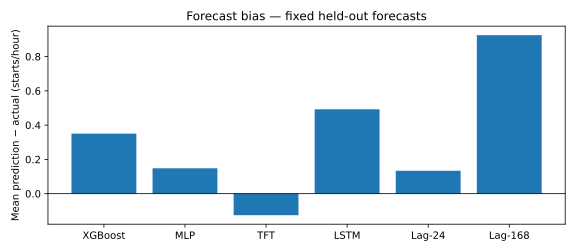
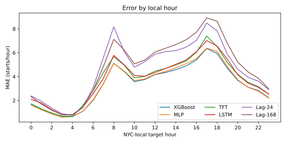
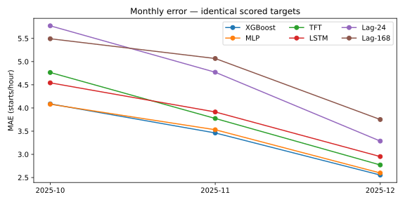

# Forecasting v1: descriptive error diagnostics

These diagnostics analyze the **saved six-method test predictions**, not new inference.
They do not change training, checkpoint selection, clipping, eligibility or the original
benchmark. The source SHA-256 is
`4f726d274a1d3090078f7663cc591e2d560d06d332056d168c6c38289f95accd`;
all 220,800 paired keys and original full-precision MAE/RMSE/WAPE are rechecked.
The original [follow-up benchmark](six_model_followup_benchmark.md) remains authoritative.
MLP and LSTM were developed after the initial four-model test results were disclosed;
this is a follow-up extension, not a fully blind six-model experiment.

## Bias and station variation

Signed error is prediction minus accepted recorded starts, in starts/station/hour.
Positive values mean aggregate overprediction; signs can differ within subgroups.

| Method | Mean signed error | Median station MAE | Station MAE p10–p90 |
| --- | ---: | ---: | ---: |
| XGBoost | +0.3501 | 3.2007 | 2.7737–4.3024 |
| MLP | +0.1479 | 3.2398 | 2.8123–4.3495 |
| TFT | −0.1257 | 3.5323 | 3.0574–4.8044 |
| LSTM | +0.4922 | 3.6582 | 3.1088–4.7828 |
| Lag-24 | +0.1336 | 4.5181 | 3.5534–5.9973 |
| Lag-168 | +0.9250 | 4.5652 | 3.8212–6.2922 |

All 100 station MAEs are exported to the local `station_id.csv` (600 model/station
rows). Activity groups use **training-only frozen scaler means**, ascending rank
with station-ID ties: lower 34, middle 33, higher 33. XGBoost MAE is respectively
2.9398, 3.1434 and 4.0287; higher absolute errors at busier stations do not by
themselves imply worse relative accuracy. This grouping never uses test demand.




## Time patterns

| Method | October MAE | November MAE | December MAE | Weekday / weekend MAE |
| --- | ---: | ---: | ---: | ---: |
| XGBoost | 4.0874 | 3.4611 | 2.5535 | 3.3788 / 3.3346 |
| MLP | 4.0804 | 3.5303 | 2.5981 | 3.4322 / 3.3238 |
| TFT | 4.7645 | 3.7733 | 2.7710 | 3.8445 / 3.5793 |
| LSTM | 4.5414 | 3.9135 | 2.9518 | 3.8614 / 3.6479 |
| Lag-24 | 5.7709 | 4.7698 | 3.2858 | 4.5249 / 4.8159 |
| Lag-168 | 5.4921 | 5.0662 | 3.7507 | 4.7152 / 4.8965 |

Weekday commute peaks are target hours 07–09 and 16–18 inclusive in
America/New_York (39,600 targets). Every other scored hour is off-peak (181,200).
XGBoost peak/off-peak MAE is 5.5862/2.8812; TFT is 6.4753/3.1783.
These are descriptive comparisons, not causal explanations of errors.

The local-hour table retains both November fall-back 01:00 buckets, distinguished
by their UTC identities. Exactly 24 elapsed-hour targets are scored per origin.
The November 2 origin ends at 22:00 EST; the following 23:00 EST bucket is outside
that horizon (100 unscored station-hours), as in the original benchmark.




## Interpreting the metrics

Mean target counts decline from 13.6724 in validation to 9.0680 in test. WAPE is
100 × MAE / mean actual count on the same eligible targets. Absolute error fell,
but by a smaller proportion than this denominator, so WAPE increased. This is
consistent with a lower-volume test period; it does not establish its cause.

XGBoost and MLP differ by just 0.03519 starts/hour in aggregate test MAE. MLP is
slightly better in October, while XGBoost leads in November and December. No
statistical significance or universal station-level superiority is established.
TFT has lower MAE than LSTM, while LSTM has lower RMSE: squared error assigns
more weight to large errors, so the rankings need not agree.

TFT q10–q90 empirical coverage remains **79.495%**, compared with nominal 80%.
Clipped pinball losses remain q10 **0.718650**, q50 **1.884786**, q90 **1.020873**;
their mean is **1.208103**. These quantiles express conditional forecast
uncertainty, unlike the other point forecasts. Aggregate coverage alone does not
prove calibration by station, season or hour, and intervals do not describe
unobserved physical demand or station operating status.

## Reproduce without running models

With existing authorized ADC and the project's cloud/diagnostics dependencies:

```sh
PYTHONPATH=src python scripts/provision_forecasting_v1.py --diagnostics
PYTHONPATH=src python scripts/forecasting_diagnostics.py \
  --output outputs/forecasting-v1/diagnostics-review
```

Provisioning restores only pinned small serving artifacts and a 17.36 MB saved
prediction file. Analysis reads those saved forecasts; it imports no model runtime
and calls no inference. Output directories are create-only. Tables and provenance
stay gitignored; the four small SVGs above are the documentation exports.
