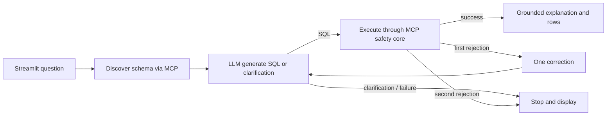

# SQLPilot application: LangGraph + MCP + Streamlit

This milestone implements a standalone application, not a Codex wrapper. The
application owns its LangGraph invocation and official MCP SDK client. **Live LLM
execution is pending provider/account/data-sharing approval.** Mocked generation
is never presented as text-to-SQL accuracy.

## Implemented flow



`graph.py` uses a real compiled `StateGraph`: `discover_schema`, `generate_sql`,
`execute_sql`, `repair`, `explain`, with conditional transitions. State tracks the
question, schema, SQL, attempts, MCP tool count, result, status and sanitized trace.
There is no persistent conversation memory or external checkpoint store. A
clarification is shown to the user, who submits a more specific question next.

Bounds are two generation attempts, three MCP tool calls (one schema plus at most
two SQL executions), graph recursion limit ten, and a 60-second invocation timeout.
Generation/network failures end safely; there is no unlimited API retry. Existing
DuckDB limits remain **unchanged**: physical-table/column/function allowlists,
read-only connections, native AST checks, one SELECT, 64 MB engine memory, one
thread, five-second worker deadline, disabled external access/spill, 100 rows and
128 KiB response cap. See [core security boundary](sqlpilot_core.md).

The agent imports no DuckDB executor: `client.py` uses the **official MCP SDK**,
starts the existing stdio server, initializes it, discovers the two tools and calls
`sqlpilot_schema` / `sqlpilot_query`. Real calls negotiated protocol **2025-03-26**
with SDK 1.26.0. Only an operator may select the database or interpreter; neither
can be supplied by a question, generated SQL or tool arguments. Provider credentials
are not forwarded into the database server's environment.

Explanations are deterministic statements grounded in returned rows, columns and
sample scope. Rows are not sent to an LLM for an additional narrative call.
Trace records contain node outcomes, attempts, SQL hashes, tool names, timing and
row counts, not credentials, questions or raw query rows. They remain in the local
session unless explicitly exported. Automatic LangSmith tracing is disabled even
when tracing environment variables exist; Streamlit usage telemetry is disabled.
No MCP/model tracing service was provisioned.

## Isolated environment and startup

Frameworks were absent from the forecasting environment. A separate ignored
`.venv-sqlpilot` was created with Python 3.11; existing model environments were not
modified. Pinned application dependencies are in `requirements/sqlpilot-app.txt`:
LangGraph **1.2.18**, MCP **1.26.0**, Streamlit **1.66.1**, DuckDB **1.5.6**, HTTPX
**0.28.1**, NumPy **2.4.6**, pandas **3.0.6**, Arrow **23.0.1**. The resolved transitive versions are recorded in `sqlpilot-app.lock.txt`.
No local LLM or ML framework is needed. The direct application extra is `sqlpilot-app`; tests and
exact direct dependency pins are in the requirements file.

For a fresh setup, after checking resources:

```sh
python3.11 -m venv .venv-sqlpilot
.venv-sqlpilot/bin/python -m pip install -r requirements/sqlpilot-app.txt
```

Keep the MCP/query worker lean. The new UI environment's first pandas import on
the memory-pressured Mac exceeded the existing worker deadline; inspection showed
import work, not a completed analytical query. Data-library alignment alone did
not resolve it. **The deadline was not increased.** The verified local setup reuses
the existing core interpreter, which loads no forecasting models:

```sh
export PYTHONPATH=src
export SQLPILOT_MCP_PYTHON="$PWD/.venv/bin/python"
export OPENBLAS_NUM_THREADS=1
export OMP_NUM_THREADS=1
.venv-sqlpilot/bin/python -m streamlit run src/citypulse_ai/sqlpilot/ui.py \
  --server.address 127.0.0.1 --server.port 8501
```

The default database is the existing small sample documented in the core guide.
`SQLPILOT_DATABASE` may select another trusted, schema-compatible small sample.
No user-facing database picker or arbitrary server-command input is provided.
Stop the foreground UI with Ctrl-C. It does not launch Ollama, connect to GCP or
load model weights. Do not interpret this as permission to load a heavy model
while macOS pressure remains elevated.

On a fresh machine without the original environment, make a minimal core runtime:

```sh
python3.11 -m venv .venv-sqlpilot-core
.venv-sqlpilot-core/bin/python -m pip install duckdb==1.5.6 pytz==2026.5
export SQLPILOT_MCP_PYTHON="$PWD/.venv-sqlpilot-core/bin/python"
```

Without this optional setting the MCP server uses the application interpreter;
that is suitable only when its worker startup fits the existing deadline. CI tests
use the explicit lean-runtime arrangement. This is ordinary version-independent
MCP process separation, not dependence on Codex or its model access.

## Interface

The UI provides question entry, generated SQL, actual result table, grounded
explanation, clarification/error messages and expandable agent/MCP traces.
“Inspect permitted schema” makes a real MCP call even without an LLM and displays
the schema fingerprint for operator review. The status explicitly distinguishes
unconfigured/approval-pending from configured-but-not-live-verified. A successful
real generation can mark the last invocation verified; it is not a continuous
provider health probe. No fake/demo LLM mode is exposed to users. SQL and model
text are displayed without unsafe HTML; explanations/clarifications use plain text.

## LLM provider: implemented adapter, live access NOT approved

Groq is a **candidate**, not an activated account. Its official documentation lists
[a Free Plan](https://console.groq.com/docs/rate-limits), [billing requirements](https://console.groq.com/docs/billing-faqs)
and [JSON/structured output support](https://console.groq.com/docs/structured-outputs).
These establish provider capabilities, **not this user's allowance or model access**.
No API key, approved model or current free-account confirmation was supplied.
Therefore no request to a model endpoint was made.

`HostedJSONBackend` implements the existing `Backend.generate(question, schema)`
contract with a bounded HTTPX call and JSON decision (`sql` or `clarification`).
The graph, not the provider, chooses MCP tools. Configuration can select Groq or
another explicitly approved HTTPS OpenAI-compatible endpoint; alternate endpoints
require an exact endpoint approval match. Redirects and environment proxies are
disabled. The implementation adds no OpenAI/Groq SDK dependency or paid fallback.
A model must be explicitly chosen and its JSON-mode/free-quota compatibility
confirmed before use.

The following operator configuration is intentionally **unset**:

- `SQLPILOT_PROVIDER=groq` and `SQLPILOT_MODEL=<approved model ID>`.
- A locally stored `GROQ_API_KEY` (or `SQLPILOT_API_KEY`), never in Git/UI/traces.
- `SQLPILOT_PROVIDER_APPROVED=groq` after user approval.
- `SQLPILOT_FREE_ALLOWANCE_VERIFIED=yes` after current account/remaining-quota checks.
- `SQLPILOT_APPROVED_SCHEMA_SHA256=<reviewed fingerprint>`.
- `SQLPILOT_QUESTIONS_APPROVED=yes` after approving the questions/data-sharing scope.

For `SQLPILOT_PROVIDER=openai-compatible`, provider approval must match that name;
`SQLPILOT_ENDPOINT` must exactly match `SQLPILOT_APPROVED_ENDPOINT`, use HTTPS and
contain no credentials/query/fragment. A free allowance still must be verified.
These flags are operator attestations, **not a provider billing API or hard spending
cap**. Do not set them merely to bypass the approval gate. Questions, allowed schema
(including sample row counts), and bounded prior SQL/error feedback may leave the
machine; source rows and query results are never included in generation requests.
No quota upgrade or paid plan is activated automatically; rate-limit failures end
with an error. Confirm sufficient free quota before any evaluation batch.

## Tests and evaluation foundation

**Local verification: 13 application tests and the unchanged 42 core tests passed.**
Controlled generation tests use **real LangGraph, real MCP client/server processes
and real DuckDB execution**. They verify success, clarification/unanswerable paths,
one correction, repeated attack rejection, budgets, schema failure, SDK discovery,
provider approval/HTTP payload boundaries and Streamlit AppTest interaction.
Streamlit's successful-result test substitutes generation only; it does not bypass
the graph or MCP execution. HTTP provider tests use `MockTransport`, not a live LLM.

A controlled-generation probe on the existing real sample returned **1,998 starts**,
with two MCP tool calls and about **2.15 seconds** elapsed. Its trace recorded
schema → generation → execution → explanation and `live_llm_exercised=false`.
A later native smoke probe returned the same 1,998 starts in **1.53 seconds**.
Streamlit's real localhost health and page requests both returned HTTP **200**;
its idle server RSS was **52,330,496 bytes**. The controlled graph plus MCP/query
process tree peaked at **249,741,312 sampled RSS bytes** (about 238 MiB). All test
processes exited. The isolated environment occupies about **510 MiB** on disk.
These are small-probe observations, not full-concurrency memory guarantees.
This proves integration, not real text-to-SQL quality.

```sh
PYTHONPATH=src SQLPILOT_MCP_PYTHON="$PWD/.venv/bin/python" \
  .venv-sqlpilot/bin/python -m pytest tests/test_sqlpilot_app.py -q
PYTHONPATH=src .venv/bin/python -m pytest tests/test_sqlpilot.py -q
```

`tests/fixtures/sqlpilot_questions.json` freezes **nine questions**: six answerable
queries with reference SQL and synthetic-fixture expected rows; ambiguity,
unobserved physical demand and prompt injection require clarification. References
are verified through real MCP. Fixture expected values are never asserted as real
historical counts. The future evaluator recomputes reference rows through MCP on
the operator-selected database and scores actual generated results with numerical
tolerance, execution status, clarification status, query-tool rejections and latency.
Clarification-content quality will additionally need human review.

```sh
# Remains disabled without the explicitly approved live backend configuration:
PYTHONPATH=src .venv-sqlpilot/bin/python -m citypulse_ai.sqlpilot.evaluate_graph \
  --database outputs/historical/samples/2024-01-n1000/citypulse.duckdb \
  --output outputs/sqlpilot/live-evaluation.json
```

Without approval this writes `live_backend_pending`, zero evaluated cases and no
model calls. Output files are create-only and gitignored. Live evaluation is bounded
to ten questions and two generation attempts per question; do not run a batch if
its possible token/request demand exceeds the verified free quota.

## Remaining milestone

Approve a provider, current free allowance, explicit model and outbound schema/
question scope, then exercise genuine LLM generation and evaluate the frozen set.
The current agent/UI milestone is **not SQLPilot v1 accuracy certification**. MCP
protocol expansion, persistent dialogue, authentication for any hosted UI and
Docker packaging remain future work. LangGraph is now real orchestration; expanded
MCP, vLLM and possible QLoRA remain roadmap goals, with no fine-tuning started.
